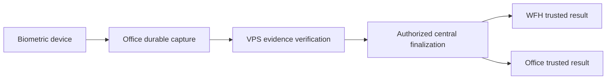

# Attendance Management: controlled real-infrastructure pilot

Recorded 2026-10-29. This is the next milestone after backend and desktop UI
completion and verification. It does not authorize production migration, role
changes, worker activation or hardware access now.

| Installation                            | Intended pilot responsibility                                                                        |
| --------------------------------------- | ---------------------------------------------------------------------------------------------------- |
| VPS, PostgreSQL 18 `payroll_central`    | HTTPS sync, evidence verification, central review/finalization and trusted results                   |
| Office PC, its local `payroll_sys`      | LAN biometric capture, durable offline evidence, reconnect delivery and authoritative result receipt |
| WFH laptop, its own local `payroll_sys` | Remote attendance review/approval and synchronized authoritative results                             |

The required flow is:

## Implementation and review sequence

1. Verify Step 73N-B in isolated `hexpayroll_test`, including source completeness,
   explicit source exceptions, canonical finalization and two-PC trusted delivery.
2. Build the Attendance Management desktop UI: daily attendance, missing punches,
   exception review, approvals, source limitations, sync status and historical
   audit. Clearly distinguish local capture, receipt, certification and approval.
3. Run the complete regression and security checks, including duplicates,
   conflicting evidence, offline recovery, restart and database integrity.
4. Prepare a concrete migration/activation plan: inspect existing databases and
   pending outboxes, verify backups through a restore rehearsal, review restricted
   roles, central user sessions and independent reviewer/approver provisioning,
   and define rollback/disable steps. Explicitly review and authorize the plan
   before touching either real database.
5. Enforce a small pilot employee/device/node scope and isolate operational data.
   Verify that scope across all enabled workers and streams; a UI employee filter
   alone is insufficient. Existing generic/trusted streams and pending work must
   be reviewed before activation. Resolve or safely isolate the Step 73M immutable
   history/different-UUID blockers without deleting or remapping their history.
6. Assess the exact biometric model, firmware and SDK over the Office LAN. Test
   capture, disconnect/reconnect, durable identities/epochs, inventory and sealed
   window capabilities. No model gets automatic completeness from its name or a
   checkpoint. Unsupported devices require the reviewed exception policy and
   retain their limitation in final attendance audit.
7. Activate only the reviewed pilot components and test Office → VPS → WFH and
   VPS → Office convergence, including loss of internet and restart at each
   receipt/finalization boundary. Repeated delivery must preserve identity and
   produce identical authoritative revisions without outbox echo.

Organization-wide rollout and payroll calculations remain outside this pilot.
Real infrastructure does not become authorized merely because automated tests
pass. Until the reviewed rollout is explicitly authorized, database execution
continues to use isolated `hexpayroll_test` schemas only.
